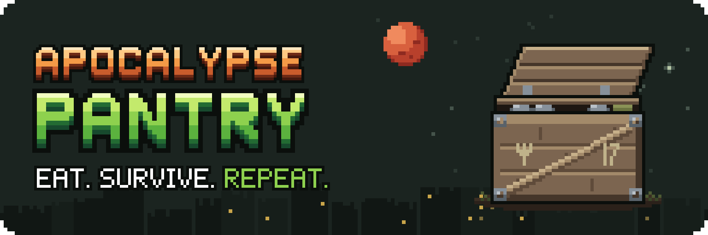

<p align="center"></p>

**Food for the end of the world.** 17 survival foods and five effects built around a zombie apocalypse.
The mod page text is in [`page/docs/description.md`](page/docs/description.md).

# Apocalypse Pantry — аддон для Farmer's Delight: еда для зомби-апокалипсиса

* **Minecraft 1.18.2 – 26.3** на **Forge, NeoForge и Fabric** — те же версии, что у Stardew Delight (таблица ниже)
* Требуется **Farmer's Delight**; на Fabric — **Farmer's Delight Refabricated** и **Fabric API**
* Нужен и на клиенте, и на сервере

## Версии
| Minecraft | Загрузчик | Файл |
|---|---|---|
| 26.3 | Fabric | `apocalypsepantry-fabric-26.3-1.0.0.jar` |
| 26.2 | Fabric | `apocalypsepantry-fabric-26.2-1.0.0.jar` |
| 26.1 – 26.1.2 | Fabric | `apocalypsepantry-fabric-26.1-1.0.0.jar` |
| 1.21.11 | Fabric | `apocalypsepantry-fabric-1.21.11-1.0.0.jar` |
| 1.21.9 – 1.21.10 | Fabric | `apocalypsepantry-fabric-1.21.10-1.0.0.jar` |
| 1.21.6 – 1.21.8 | Fabric | `apocalypsepantry-fabric-1.21.8-1.0.0.jar` |
| 1.21.5 | Fabric | `apocalypsepantry-fabric-1.21.5-1.0.0.jar` |
| 1.21.1 | NeoForge | `apocalypsepantry-neoforge-1.21.1-1.0.0.jar` |
| 1.21.1 | Fabric | `apocalypsepantry-fabric-1.21.1-1.0.0.jar` |
| 1.20.1 | Forge | `apocalypsepantry-forge-1.20.1-1.0.0.jar` |
| 1.20.1 | Fabric | `apocalypsepantry-fabric-1.20.1-1.0.0.jar` |
| 1.19.2 | Forge | `apocalypsepantry-forge-1.19.2-1.0.0.jar` |
| 1.18.2 | Forge | `apocalypsepantry-forge-1.18.2-1.0.0.jar` |

## Что в моде
* **17 блюд** (`Foods.java`) и пустая банка. Предметы — `ConsumableItem` / `DrinkableItem` из Farmer's Delight: консервы
  оставляют пустую банку, вода, чай и соления — стеклянную бутылку, похлёбка — миску, крыса — палку.
  Кастрюля FD сама просит эту тару при готовке. Своих подсказок у предметов нет.
* **5 эффектов** (`EffectLogic.java`, миксины в `mixin/`):
  * **Заражение** — удар зомби, кадавра, утопленника или зомби-жителя: 10 % на «Нормально», 25 % на «Сложно».
    Голод тратится в 1,5 раза быстрее, через 5 минут — Слабость, через 10 — Замедление. Длится час. Молоко и тотем
    его не снимают, лечит только травяной чай. Если игрок умирает заражённым, на месте смерти появляется зомби
    с его именем.
  * **Мёртвый запах** — нежить не выбирает игрока целью, пока он сам её не ударит; удар снимает эффект.
  * **Адреналин** — Скорость II и Прыгучесть I; когда кончается — **Отходняк** (Замедление и Усталость, 0:30),
    его снимает вода.
  * **Запас сил** — голод тратится вдвое медленнее.
* Рецепты — `tools/gen.py`: кастрюля Farmer's Delight (консервы, напитки, лапша, похлёбка, соления), разделочная доска
  (вяленое мясо), верстак (пайки, батончики, галеты), коптильня и костёр (вяленая плоть зомби), переплавка банки.
  Теги и формат рецептов для каждой версии свои, как в Stardew Delight. Эффекты FD: «Уют» у чая и лапши,
  «Сытость» у похлёбки.
* Зомби, убитые игроком, с шансом 5 % роняют консервы, галеты, энергетик или воду.

## Сборка
Один исходник на все версии — [Stonecutter](https://stonecutter.kikugie.dev/) 0.10, сборка устроена как у Stardew Delight.
```
py tools\gen.py                     # модели, текстуры, языки и данные для всех версий
py dev\build_all.py                 # все версии по очереди, логи в build/logs/
py dev\build_all.py 1.21.1-fabric   # одна версия
py dev\srv.py 1.21.1-fabric         # самопроверка на выделенном сервере (SELFTEST DONE в логе)
```
Готовые jar: `build/libs/1.0.0/apocalypsepantry-<загрузчик>-<версия MC>-1.0.0.jar`.
Текстуры — `art/make_textures.py`, значки эффектов — `art/make_effect_icons.py`, оформление страницы — `page/make_page.py`.

## Лицензия
MIT, см. [LICENSE](LICENSE).
