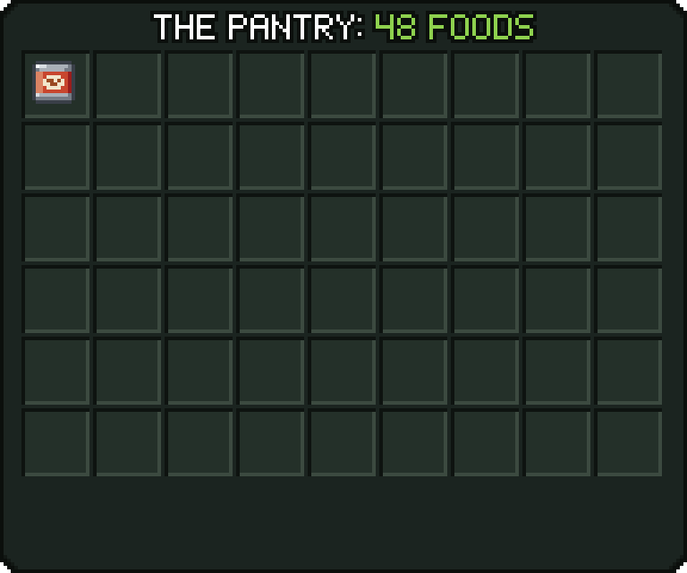

**Food for the end of the world, cooked the Farmer's Delight way: canned stew, MREs, energy drinks and zombie jerky.**

Apocalypse Pantry is an add-on for **Farmer's Delight** (**Farmer's Delight Refabricated** on Fabric). It adds 48 survival foods and five effects built around a zombie apocalypse: an Infection you catch from zombies, a scent that makes the undead ignore you, and an adrenaline rush that comes with a crash. Available for **Forge** 1.18.2, 1.19.2 and 1.20.1, **NeoForge** 1.21.1 and **Fabric** 1.20.1, 1.21.1, 1.21.5 – 1.21.11 and 26.1 – 26.3. Requires Farmer's Delight on Forge and NeoForge, Farmer's Delight Refabricated and Fabric API on Fabric.

- **48 survival foods.** From Canned Beans and Hardtack to MRE Rations, Bunker Chili and Zombie Jerky. Every food has its own texture drawn in Farmer's Delight's style.
- **Four ways to cook.** 29 foods simmer in the cooking pot, 15 are made at the crafting table, Jerky is sliced on the cutting board, and Zombie Jerky, Roasted Spider Eye and Dried Fruit are cooked in a smoker or on a campfire.
- **Farmer's Delight ingredients.** Recipes use onions, tomatoes, tomato sauce, cabbage, rice, raw pasta, wheat dough and salad greens.
- **Served like Farmer's Delight food.** The cooking pot serves canned food into an empty can, drinks and pickles into a glass bottle and stews into a bowl. You get the can, bottle or bowl back when you eat, and the stick back from skewers.
- **Empty cans.** Craft them from iron nuggets or smelt them back into an iron nugget.
- **Five new effects.** Infection, Undead Scent, Adrenaline, Crash and Stamina, see below.
- **Infection.** Zombies can infect you when they hit you. It survives milk and totems: Herbal Tea is the only cure, so keep a bottle on you.
- **Comfort and Nourishment.** Soups, teas, porridge and noodles give Farmer's Delight's **Comfort**, Survivor's Stew, Game Stew and Bunker Chili give **Nourishment**.
- **Zombie loot.** Zombies you kill sometimes drop canned food, hardtack, an energy drink or bottled water.

| Effect | What it does |
| --- | --- |
| **Infection** | Caught from zombie, husk, drowned and zombie villager hits (10% on Normal, 25% on Hard). Makes you hungry faster; after 5 minutes adds Weakness, after 10 Slowness. If you die infected, a zombie with your name rises where you fell. |
| **Undead Scent** | Zombies and other undead ignore you until you attack them. |
| **Adrenaline** | Speed II and Jump Boost I. When it ends you get a Crash. |
| **Crash** | Slowness I and Mining Fatigue I. Water clears it. |
| **Stamina** | Hunger drains half as fast. |

| Food | What it gives |
| --- | --- |
| **Survivor's Stew** | Nourishment 5:00, Resistance I 3:00, Regeneration I 0:20, Stamina 6:00 |
| **MRE Ration** | Stamina 8:00, Resistance I 2:00 |
| **Energy Drink** | Adrenaline 0:45, then Crash 0:30; resets the time since you last slept |
| **Herbal Tea** | Comfort 1:00, Regeneration I 0:10, cures Infection |
| **Zombie Jerky** | Undead Scent 2:00, Nausea 0:05 |
| **Protein Bar** | Strength I 0:45 |
| **Bunker Chili** | Nourishment 2:00, Fire Resistance I 2:00 |
| **Moonshine** | Resistance I 1:00, Nausea I 0:10 |

- **Cooking pot:** Canned Stew (beef, potato, onion), Survivor's Stew (beef, potato, carrot, brown mushroom, onion), Energy Drink (sugar, cocoa beans, glowstone dust), Herbal Tea (fern, sweet berries, salad greens) and 25 more.
- **Crafting table:** MRE Ration (Hardtack, Jerky, Chocolate Ration, paper), Hardtack (wheat dough, wheat), Pemmican (cooked beef, sweet berries ×2, paper), Mushroom Skewer (stick, brown mushroom, red mushroom) and 11 more.
- **Cutting board:** Jerky, from cooked beef or a cooked porkchop with a knife.
- **Smoker and campfire:** Zombie Jerky from rotten flesh and Roasted Spider Eye from a spider eye; Dried Fruit from an apple in the smoker.

- **Farmer's Delight** by vectorwing.

Apocalypse Pantry is released under the **MIT License**.

